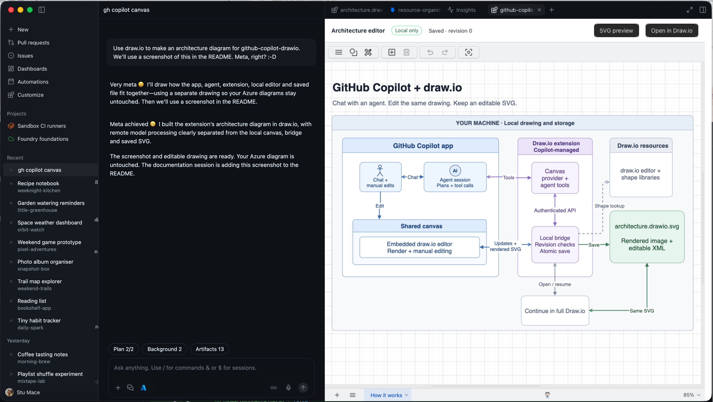

# Use Draw.io in the GitHub Copilot app canvas

**Use the GitHub App canvas to draw collaboratively with an agent.**

Work with your choice of model and agent: edit by hand, ask for changes, and keep building on the same drawing.

Agent changes respect your changes, and edits autosave to an SVG with the drawing embedded. Use **Open in Draw.io** to continue in the full application.

## Install

1. Use Copilot's **Install extension from repository** action with `https://github.com/kewalaka/github-copilot-drawio/tree/main/drawio-canvas`. Choose user-wide installation to make it available across sessions.
2. Ask Copilot to open `drawio-architecture`.

Requires an app version with SDK canvas extension support and access to this private repository. First open downloads missing browser assets; desktop draw.io.

See [DESIGN.md](DESIGN.md) for saving, handoff, privacy, upgrades and development, and [AGENTS.md](AGENTS.md) for contributor guidance.
